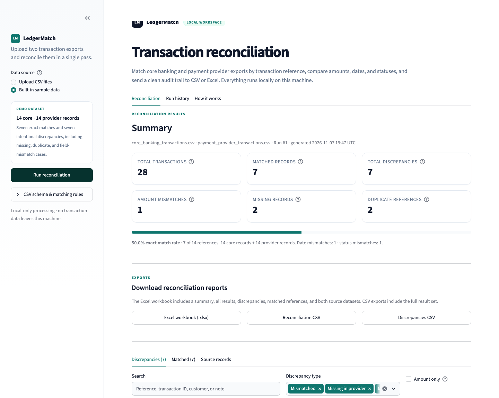

# LedgerMatch Documentation

> A local-first workspace for reconciling core banking transactions against payment provider transactions.

LedgerMatch compares two CSV transaction exports, matches records by reference, classifies discrepancies, highlights risky rows, and produces audit-ready CSV and Excel reports. A SQLite database preserves a local history of every run.



_Figure: a completed built-in demo reconciliation showing summary metrics, match rate, and export controls._

## Start here

| If you want to… | Read |
|---|---|
| Understand the product and its use cases | [Product overview](product-overview.md) |
| Understand the system design and decisions | [Architecture](architecture.md) |
| Learn exactly how matching works | [How it works](how-it-works.md) |
| See the input, result, and database schemas | [Data reference](data-reference.md) |
| Deploy, customize, or integrate it into a real workflow | [Implementation guide](implementation-guide.md) |
| Call the Python modules from code | [API reference](api-reference.md) |
| Run tests, operate it, or troubleshoot it | [Operations](operations.md) |

## What LedgerMatch does

LedgerMatch is designed around the daily control problem behind payment operations:

1. A core banking system records customer and ledger transactions.
2. A payment provider records the same transaction through a different processing path.
3. The two systems rarely agree perfectly — amounts differ, statuses lag, references go missing, or duplicate events appear.
4. An operator needs to know which records agree, which need investigation, and what evidence to retain.

LedgerMatch converts that comparison into a deterministic, repeatable workflow:

- Upload both CSV exports.
- Validate and normalize the data.
- Match transactions by reference ID.
- Compare amount, date, and status.
- Surface missing, duplicate, and mismatched cases.
- Download reconciliation reports and review prior runs.

## At a glance

| Area | Implementation |
|---|---|
| Interface | Streamlit, single-page workspace with upload, results, history, and method guide |
| Data processing | Pandas DataFrames with integer-cent money handling |
| Matching key | Exact `reference` after whitespace trimming |
| Persistent store | SQLite at `data/reconciliation.db` (configurable) |
| Reports | CSV (full and discrepancies-only) and styled `.xlsx` workbook |
| Validation | Missing columns, empty/unreadable files, invalid amounts, invalid dates, blank references/statuses |
| Automated checks | 17 tests covering matching, ingestion, persistence, and reports |
| Sample data | Two synthetic CSVs plus a built-in demo mode |
| Default access model | Local, single-user, no authentication or network data transfer |

## Quick start

From the repository root:

```bash
python3 -m venv .venv
source .venv/bin/activate
pip install -r requirements.txt
streamlit run app.py
```

On Windows, activate with `.venv\Scripts\Activate.ps1`.

Open the URL Streamlit prints (normally <http://localhost:8501>), choose **Built-in sample data** in the sidebar, and click **Run reconciliation**.

The demo contains 28 transaction rows across 14 references and intentionally produces 7 discrepancies. See [How it works](how-it-works.md#worked-example) for the exact expected records.

## Documentation map

### Product

- [Product overview](product-overview.md) — problem statement, users, workflows, use cases, scope, and success criteria.
- [Implementation guide](implementation-guide.md#practical-implementation-opportunities) — high-value ways to adapt the tool for real operations.

### Engineering

- [Architecture](architecture.md) — context, components, request lifecycle, storage, deployment, design decisions, and extension points.
- [How it works](how-it-works.md) — ingestion, normalization, matching algorithm, classification precedence, metrics, UI behavior, and worked examples.
- [Data reference](data-reference.md) — CSV contracts, normalized source schema, result schema, summary keys, SQLite tables, and report formats.
- [API reference](api-reference.md) — public Python functions, dataclasses, exceptions, constants, and embedding examples.

### Operations

- [Operations](operations.md) — test commands, verification, database backup, failure handling, monitoring, security, and FAQ.

## Repository structure

```text
.
├── app.py                         # Streamlit UI and orchestration
├── recon/
│   ├── engine.py                  # Ingestion, validation, normalization, matching
│   ├── db.py                      # SQLite schema and history access
│   └── reports.py                 # CSV and Excel report builders
├── sample_data/                   # Synthetic demonstration exports
├── tests/                         # Automated reconciliation tests
├── docs/                          # This documentation
├── .streamlit/config.toml         # UI theme
├── requirements.txt
├── pytest.ini
└── README.md                      # Project quick start
```

## Demo result

| Metric | Value |
|---|---:|
| Total transaction rows | 28 |
| Core records | 14 |
| Provider records | 14 |
| Unique references | 14 |
| Exact matches | 7 |
| Total discrepancies | 7 |
| Amount mismatches | 1 |
| Date mismatches | 1 |
| Status mismatches | 1 |
| Missing records | 2 |
| Duplicate references | 2 |
| Exact match rate | 50.0% |

## Conventions used in these docs

- Paths such as `recon/engine.py` are relative to the repository root unless stated otherwise.
- “Reference” means the shared business transaction identifier used for matching.
- “Core” means the core banking source; “provider” means the payment provider source.
- “Row” usually means a CSV record. Reconciliation results are **per reference**, not per raw row; duplicate references aggregate multiple rows into one result case.
- Amounts are described in major currency units in the UI and reports, but compared internally in cents.

## Status and scope

LedgerMatch is a local operational and audit-support tool. It is not a payment processor, ledger system, general ledger, or enterprise identity platform. It has no authentication, external API, or multi-tenant isolation. The [Implementation guide](implementation-guide.md) describes the work required to harden it for a shared production environment.
