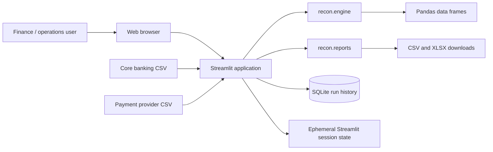
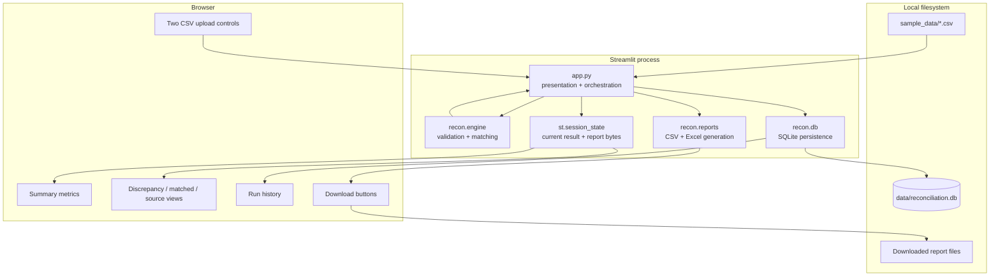
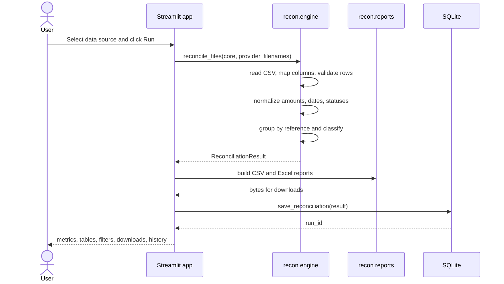
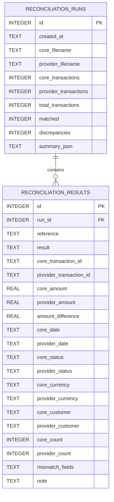
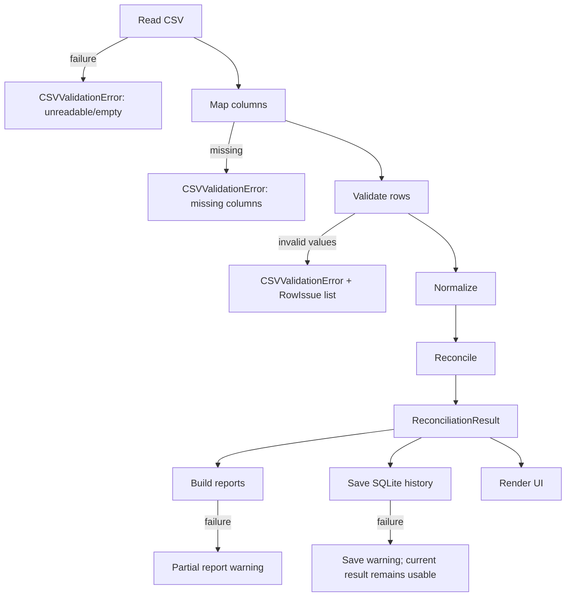
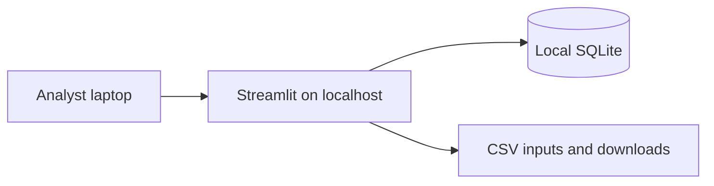
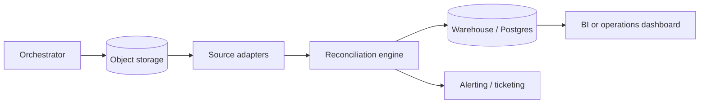

# Architecture

## Architectural goals

LedgerMatch is deliberately small. The architecture optimizes for:

1. **Correctness and explainability** over automation.
2. **Local operation** with no external services required.
3. **A short path from CSV to evidence** — upload, reconcile, review, export.
4. **A testable core** that is separate from the Streamlit interface.
5. **Explicit data contracts** that can be reused by future integrations.

The implementation is a single-process Streamlit application backed by a small Python library. There is no API server, message queue, warehouse dependency, or external authentication service.

## System context

**Trust boundary:** everything runs on the local machine or host chosen by the operator. LedgerMatch does not call a third-party API with transaction data.

## Container view

## Module responsibilities

| Module | Responsibility | Key entry points |
|---|---|---|
| `app.py` | Streamlit layout, input mode, error presentation, filters, highlighting, downloads, history UI, session state | `main()`, `render_sidebar()`, `handle_run()`, `render_results()`, `render_history()` |
| `recon/engine.py` | CSV reading, column mapping, validation, normalization, reference grouping, field comparison, result and summary construction | `load_transactions()`, `reconcile_transactions()`, `reconcile_files()` |
| `recon/db.py` | SQLite schema, run persistence, run listing, detail retrieval, timestamp formatting | `initialize_database()`, `save_reconciliation()`, `list_runs()`, `get_run()` |
| `recon/reports.py` | Human-readable column naming, CSV generation, styled multi-sheet Excel generation, spreadsheet formula neutralization | `build_csv_report()`, `build_excel_report()` |
| `tests/test_reconciliation.py` | Logic, validation, persistence, and export regression tests | `pytest` |

The core engine has no Streamlit dependency. It can be imported from scripts, tests, scheduled jobs, or a future API service.

## Request lifecycle

A Streamlit rerun (for example, changing a filter) reuses the result and prepared report bytes from `st.session_state`; it does not rematch the files.

## End-to-end data flow

### 1. Source selection

The sidebar supports two input modes:

- **Upload CSV files** — each upload is read as bytes and passed with its filename.
- **Built-in sample data** — the two files under `sample_data/` are read from disk.

### 2. Ingestion

`recon.engine.load_transactions()` accepts bytes, text/binary file-like objects, or a filesystem path. It reads the CSV as strings so that formatting and validation are explicit rather than inferred silently.

### 3. Column mapping

Headers are normalized to lowercase snake case. Required logical columns are mapped from known aliases:

- `reference`
- `amount`
- `transaction_date`
- `status`

Optional fields are mapped when present:

- `transaction_id`
- `customer_name`
- `description`
- `payment_method`
- `currency`

Missing required columns produce a `CSVValidationError` rather than a partial reconciliation.

### 4. Row validation and normalization

Each row is validated:

- Reference must be non-empty.
- Amount must parse to a finite currency value.
- Date must parse to a calendar date.
- Status must be non-empty.

Amounts are stored as integer cents for exact comparison. Dates become ISO `YYYY-MM-DD` strings. Status keys are trimmed, whitespace-collapsed, and uppercased for comparison. All invalid values are collected into `RowIssue` objects before raising, so the UI can show a useful error list.

### 5. Matching

The engine groups normalized rows by reference and classifies each group. Classification is per reference:

- One core + one provider row → compare fields.
- Zero core or zero provider rows → missing.
- More than one row in either source → duplicate.

### 6. Presentation and export

The result contains:

- A detailed per-reference DataFrame.
- Normalized source DataFrames.
- A summary dictionary.
- Source filenames and a UTC generation timestamp.

The UI renders metrics and filtered tables from these artifacts. Report builders convert column names to human labels and generate downloadable files.

### 7. Persistence

Each completed run stores:

- Run metadata and summary JSON.
- Per-reference detail rows.

The raw uploaded source rows are **not** stored in SQLite. The current session retains them for the source-record view; saved history contains the reconciliation details needed for review.

## State management

Streamlit reruns the script on each interaction. LedgerMatch uses `st.session_state` for:

| Key | Purpose |
|---|---|
| `recon_result` | Current `ReconciliationResult` |
| `last_run_id` | SQLite run id for the current result |
| `run_error` | Structured validation/general error for display |
| `report_payload` | Prepared Excel/CSV bytes for downloads |
| `report_warning` | Partial report-generation failure message |
| `save_warning` | Persistence failure message |
| `db_warning` | SQLite initialization failure message |
| widget keys | Filter/search state such as `discrepancy_types` |

The database is not used for application state during an active run. It is initialized at startup and accessed with short-lived connections.

## Persistence architecture

The complete DDL, column descriptions, and summary keys are in the [Data reference](data-reference.md#sqlite-schema).

## Key design decisions

### D1 — Local Streamlit application instead of a web service

**Decision:** use Streamlit as the presentation and orchestration process.

**Rationale:** the target workflow is a small operational tool. Streamlit provides uploads, tables, downloads, and a local server without building a frontend/backend split.

**Consequence:** the UI and core logic currently share one process. For multi-user deployment, add authentication, HTTPS, and host-level isolation; for service integration, expose the engine through an API or job runner.

### D2 — Exact reference matching only

**Decision:** group by exact reference after trimming whitespace.

**Rationale:** deterministic, explainable behavior is more important than attempting probabilistic matching in a financial control. A fuzzy match that silently pairs the wrong records is dangerous.

**Consequence:** inconsistent reference conventions between systems remain an upstream data-quality issue. Fuzzy matching could be added as a warning-only layer; see [Extension points](#extension-points).

### D3 — Integer cents for amount comparison

**Decision:** parse amounts to `Decimal`, quantize to two decimal places, and store integer cents for comparison.

**Rationale:** avoids floating-point artifacts such as `0.1 + 0.2`.

**Consequence:** currencies with different minor units need explicit configuration in a future extension. The display layer converts cents back to major units.

### D4 — One result row per reference

**Decision:** the reconciliation detail table is reference-level.

**Rationale:** an operator investigates a reference and its relationships, not an arbitrary row pairing. It also gives a stable grain for history and reporting.

**Consequence:** duplicate groups aggregate IDs and use the first record’s values in the detail row. The source-record view and source sheets preserve every raw row.

### D5 — Duplicates take precedence over matching

**Decision:** if either source has more than one row for a reference, the reference is classified as a duplicate rather than matched.

**Rationale:** silently selecting a row can conceal a double capture or a data duplication. The conservative outcome is safer.

**Consequence:** a duplicate reference that is also absent from the other source is reported as a duplicate, with a note that no counterpart was found.

### D6 — Calendar-day date comparison

**Decision:** parse timestamps and compare normalized calendar dates.

**Rationale:** provider and bank exports often differ in time-of-day due to processing latency; a day-level comparison reflects the operational reconciliation boundary.

**Consequence:** intraday timing discrepancies are not surfaced. Time-zone handling follows UTC normalization in the parser.

### D7 — Status normalization without semantic mapping

**Decision:** trim, collapse whitespace, and uppercase statuses before comparison; do not map `SUCCESS` to `COMPLETED` automatically.

**Rationale:** status vocabularies are organization-specific. Silently treating different statuses as equal can hide a real failure.

**Consequence:** cross-system status mapping is a configuration extension for production integrations.

### D8 — SQLite for history

**Decision:** use a single local SQLite database with a run table and a result table.

**Rationale:** zero external infrastructure, simple backup, durable local audit history, and easy to inspect.

**Consequence:** SQLite is single-process-oriented and not intended for high-concurrency multi-user writes. Use a server database if the tool becomes a shared service.

### D9 — Reports generated in memory

**Decision:** build CSV/XLSX bytes in memory and hand them to Streamlit download buttons.

**Rationale:** no file cleanup, no shared report directory, and each operator receives exactly the current run.

**Consequence:** report generation uses memory proportional to the dataset. Very large files need streaming or server-side report storage.

### D10 — Fail closed on invalid input

**Decision:** reject the entire reconciliation if any row has an invalid required value.

**Rationale:** a partially reconciled financial dataset can create false confidence. The error is explicit and lists the rejected rows.

**Consequence:** dirty exports require correction or an intentional preprocessing step. A future “skip invalid rows with an explicit exception log” mode could be added if operations requires it.

### D11 — Spreadsheet formula neutralization

**Decision:** prefix textual values starting with `=`, `+`, `-`, or `@` with an apostrophe in exports.

**Rationale:** prevents formula injection when exported CSVs or workbooks are opened in Excel.

**Consequence:** a reference such as `-TXN-1` is displayed with a leading apostrophe in reports. This is an intentional security tradeoff.

## Error-handling architecture

Error boundaries are intentionally separate:

- **Input errors** stop the run and are shown with row-level detail.
- **Report errors** do not block the result; available formats are still offered.
- **Persistence errors** do not block the result; the operator is warned that history was not written.
- **Unexpected errors** are caught at the orchestration layer and shown as a general reconciliation error instead of crashing the page.

## Deployment topologies

### Supported: local workstation

This is the intended default. No network exposure is required.

### Supported with hardening: internal shared host

Run Streamlit behind an authenticated reverse proxy with TLS, restrict network access, use an isolated service account, and place the SQLite file on a protected volume. Add authentication and audit controls before sharing transaction data among users.

### Containerized batch/UI host

Containerize the app and mount `/app/data` as a persistent volume for SQLite. Uploads and downloads remain request-scoped. Configure the host's authentication and TLS layer. For scheduled reconciliation, call the engine from a separate job rather than driving the UI with synthetic requests.

### Future: batch pipeline and warehouse integration

This topology preserves the same matching semantics while replacing CSV uploads with managed ingestion and adding scheduling, alerting, and retention controls.

## Scalability characteristics

The current design loads each file into a Pandas DataFrame, joins/groupings by reference, builds detail rows, and generates the complete exports in memory. It is appropriate for file-based operational batches, but no formal benchmark is included.

| Dimension | Current behavior | Scaling approach |
|---|---|---|
| File size | Whole file in memory | Chunked ingestion or database staging |
| Result table | All rows rendered in Streamlit grid | Server-side pagination/filtering |
| Excel export | Entire workbook in memory | Row limits, streaming/XlsxWriter, or scheduled report storage |
| History | One SQLite file | PostgreSQL/managed database with retention and indexes |
| Concurrency | Local single user | Auth, external session store, worker separation |
| Matching | Pandas group-by in memory | SQL joins or distributed processing for very large volumes |
| Scheduling | Manual button | CLI/cron/Airflow/Prefect wrapper around engine |

Excel has a hard worksheet row limit of 1,048,576 including headers. Very large reconciliations should use CSV or a database-backed report.

## Security architecture

### Current boundary

- Local process and local files.
- No external network calls for transaction processing.
- No authentication or role separation.
- Uploaded transaction data is processed in memory.
- SQLite stores derived reconciliation details, including references, customer names, amounts, dates, and statuses.
- TLS and host access control are deployment responsibilities.

### Existing safeguards

- CSV validation fails closed.
- Spreadsheet formula injection is neutralized in CSV/Excel exports.
- SQL values are parameterized in SQLite operations.
- Uploaded content is not embedded as raw HTML in the UI.
- Filenames are displayed through Streamlit text, not interpolated into unsafe HTML.
- Raw uploaded source rows are not persisted in the database.

### Required hardening before shared use

1. Authentication and authorization.
2. HTTPS and network restriction.
3. Encryption at rest for the storage volume and backups.
4. Retention and deletion policy for SQLite and exports.
5. PII classification and redaction where required.
6. Audit logging of user actions and downloads.
7. Database migration/versioning strategy.
8. Operational monitoring and alerting.
9. Dependency and container vulnerability scanning.
10. Backup and restore drills.

See the [Implementation guide](implementation-guide.md#production-hardening-checklist) for a full checklist.

## Extension points

| Extension | Recommended location |
|---|---|
| New source format (JSON, Parquet, database query) | New adapter returning the canonical normalized frame |
| Extra field comparison | `recon/engine.py` comparison stage and `DETAIL_COLUMNS` |
| Status synonym mapping | Config/rule layer before status comparison |
| Amount tolerance | Comparison policy with explicit tolerance metadata |
| Fuzzy reference suggestions | Warning-only enrichment; do not auto-match |
| Additional export formats | `recon/reports.py` |
| Authentication | Reverse proxy or Streamlit auth wrapper |
| Scheduled runs | CLI entry point calling `reconcile_files()` and persistence functions |
| Alerting | Callback after result creation for missing/duplicate thresholds |
| Ticket creation | Map discrepancy categories to backend workflow APIs |
| Warehouse persistence | Replace or supplement `recon/db.py` with a repository abstraction |

The domain engine currently returns immutable-enough artifacts and does not know about Streamlit, SQLite, or Excel. That separation is the primary reason it can be reused in future architectures.

## Known architectural debt

- The app is a single Streamlit script with substantial UI code and CSS.
- SQLite has no migration/version table; schema changes require an explicit migration plan.
- History has no automatic retention or redaction.
- There is no service API.
- Report generation is synchronous and in memory.
- Search and filtering happen over the full in-memory DataFrame.
- Source data is not stored with the saved run, so historical source review is not possible without the original files.
- Matching rules are code constants rather than configuration.
- Duplicate display values come from the first record in each duplicate group.
- There is no user identity attached to history runs.

These are appropriate tradeoffs for the current scope, but they should be resolved before treating the app as a multi-user financial control platform.

## Related documentation

- [How it works](how-it-works.md)
- [Data reference](data-reference.md)
- [Implementation guide](implementation-guide.md)
- [API reference](api-reference.md)
- [Operations](operations.md)
