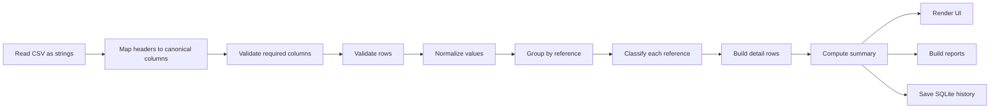
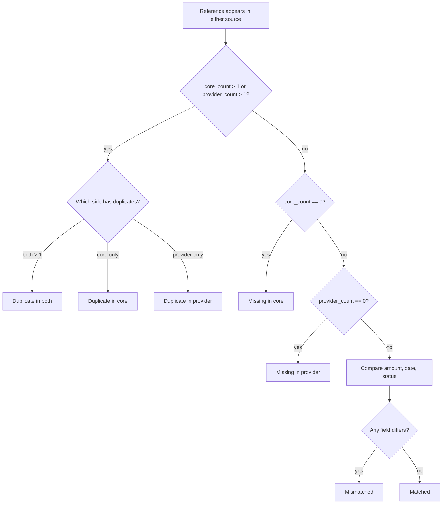
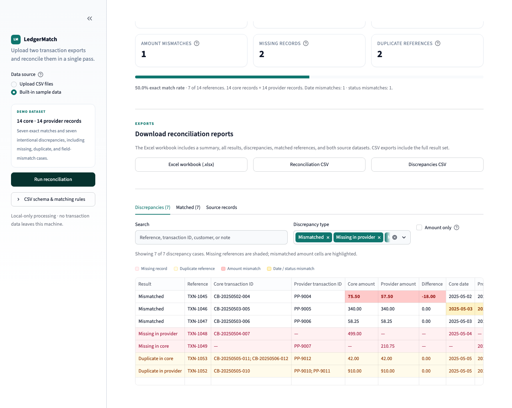

# How It Works

This page describes the complete reconciliation pipeline, including validation rules, normalization, classification precedence, summary calculations, UI behavior, and report generation.

## Pipeline overview



The core function is `reconcile_files()`:

```python
result = reconcile_files(core_source, provider_source, core_filename=..., provider_filename=...)
```

It calls `load_transactions()` for each source and then `reconcile_transactions()` on the normalized frames.

## Step 1 — Read the CSV

`load_transactions()` accepts:

- A Streamlit upload (read as bytes by the app).
- A `bytes` object.
- A text or binary file-like object.
- A `pathlib.Path` or string path.

The CSV is read entirely as strings with `keep_default_na=False`. This prevents Pandas from silently converting a malformed amount into a missing value or interpreting a reference as a number.

Common failure modes are converted to `CSVValidationError`:

| Situation | Result |
|---|---|
| Empty file | Validation error |
| Header only, no data rows | “contains no transaction rows” error |
| Invalid encoding or malformed delimiter/parsing | “could not be read as a UTF-8 CSV file” error |
| Missing required columns | Column-specific validation error |
| Invalid values in rows | Aggregated row-level validation error |

## Step 2 — Map headers

Headers are normalized by:

1. Removing a UTF-8 BOM.
2. Trimming.
3. Lowercasing.
4. Replacing runs of non-alphanumeric characters with `_`.
5. Trimming underscores.

For example:

```text
" Transaction Reference "  ->  "transaction_reference"
"Posted Date"              ->  "posted_date"
"TXN-STATUS"               ->  "txn_status"
```

The first matching alias becomes the canonical column. See [Data reference](data-reference.md#accepted-column-aliases) for the complete alias list.

Extra columns that are not recognized are ignored for comparison. Recognized optional columns (`transaction_id`, `customer_name`, `description`, `payment_method`, `currency`) are retained for display and source sheets.

## Step 3 — Validate required columns

Required logical columns:

- `reference`
- `amount`
- `transaction_date`
- `status`

If any are missing, the engine raises a `CSVValidationError` containing `missing_columns`. No reconciliation is attempted.

Example:

```text
Core banking file (bad_core.csv) is missing required column(s):
transaction_date, status. Expected columns are: reference, amount,
transaction_date, status.
```

## Step 4 — Validate and normalize rows

All rows are checked before a result is produced. This is a fail-closed policy.

### Reference

- Converted to a trimmed string.
- Blank references are rejected.
- Case is preserved.
- Matching is case-sensitive after whitespace trimming.

### Amount

The amount parser supports common operational formats:

| Input | Parsed major value |
|---|---:|
| `250.00` | 250.00 |
| `$1,234.56` | 1234.56 |
| `USD 1,234.56` | 1234.56 |
| `(25.00)` | -25.00 |
| `-75.50` | -75.50 |

Internally:

1. Currency symbols and common ISO prefixes are removed.
2. Locale-style separators are normalized.
3. The value is parsed with `Decimal`.
4. It is rounded half-up to two decimal places.
5. It is stored as an integer number of cents.

Using integer cents means `75.50` and `75.5` compare identically without floating-point drift.

### Date

Dates are parsed with Pandas using mixed-format inference and UTC normalization, then stored as `YYYY-MM-DD`. A timestamp is therefore compared by calendar day.

Examples:

- `2025-05-01` → `2025-05-01`
- `2025-05-01 14:33:00` → `2025-05-01`
- `05/02/2025` → parsed according to Pandas' inference; ambiguous formats should be normalized upstream for production use.
- `not-a-date` → row-level validation error.

### Status

A status key is produced by:

1. Trimming surrounding whitespace.
2. Collapsing internal whitespace runs.
3. Converting to uppercase.

Examples:

- `completed` → `COMPLETED`
- ` Completed ` → `COMPLETED`
- `FAILED` → `FAILED`

The original trimmed status is retained for display.

### Validation error aggregation

Every invalid row is collected as a `RowIssue` containing:

- CSV row number (`header = 1`, first data row = `2`).
- Column name.
- Human-readable issue.

If any issues exist, the entire source is rejected and the UI shows a table of invalid rows. This avoids producing a reconciliation that quietly omits records.

## Step 5 — Group by reference

Both normalized source frames are grouped by the exact `reference` value.

The set of references considered is:

```text
all references in core ∪ all references in provider
```

Results are sorted by severity first and reference second:

1. Mismatched
2. Missing in provider
3. Missing in core
4. Duplicate in both
5. Duplicate in core
6. Duplicate in provider
7. Matched

This puts actionable discrepancies at the top of exported and saved detail rows.

## Step 6 — Classify each reference

Let `core_count` be the number of rows with the reference in the core file and `provider_count` the number in the provider file.

### Classification precedence



### Decision table

| Core rows | Provider rows | Result |
|---:|---:|---|
| 0 | 1 | Missing in core |
| 1 | 0 | Missing in provider |
| 0 | >1 | Duplicate in provider (no core counterpart noted) |
| >1 | 0 | Duplicate in core (no provider counterpart noted) |
| 1 | 1 | Matched or Mismatched based on field comparison |
| >1 | 1 or >1 | Duplicate in core / both |
| 1 or >1 | >1 | Duplicate in provider / both |

A duplicate classification takes precedence over missing and mismatch classification. This is intentional: the duplicate itself is the primary operational signal, and the note explains whether a counterpart was absent.

### Field comparison

Field comparison happens only when exactly one row exists in each source.

#### Amount

```text
core_amount_cents != provider_amount_cents  ->  mismatch on Amount
```

The displayed difference is:

```text
provider_amount - core_amount
```

A negative number means the provider amount is lower than the core amount.

#### Date

```text
core_date != provider_date  ->  mismatch on Date
```

Dates are already normalized to ISO calendar days.

#### Status

```text
core_status_key != provider_status_key  ->  mismatch on Status
```

Statuses are compared after trimming, whitespace collapse, and uppercasing.

#### Mismatch fields

Fields are reported in this order:

```text
Amount, Date, Status
```

Examples:

- `Amount`
- `Date, Status`
- `Amount, Date, Status`

## Step 7 — Build detail rows

Each reference becomes one row with these display concepts:

| Concept | Meaning |
|---|---|
| Result | Classification label |
| Reference | Shared business reference |
| Core / provider transaction IDs | Internal IDs from each source, joined for duplicate groups |
| Core / provider amount | Amount in major units, from the first record in a group |
| Difference | Provider minus core, when both sides exist |
| Core / provider date | ISO date |
| Core / provider status | Display status |
| Core / provider currency | Reporting currency |
| Core / provider customer | Customer name for search and context |
| Core / provider count | Number of raw rows in the group |
| Mismatch fields | Amount/date/status fields that differ |
| Review note | Human explanation of the classification |

### Duplicate detail behavior

For a duplicate group:

- `core_count` and `provider_count` show the number of rows.
- Transaction IDs are joined with `; `.
- Amounts and other display values come from the first row in each group.
- `mismatch_fields` is blank because field-by-field comparison is not attempted.
- The note explains how many records appeared and whether a counterpart was absent.
- The source-record views preserve all underlying rows.

Example note:

```text
Reference appears as 2 provider records; review before matching.
```

## Step 8 — Compute the summary

| Summary key | Definition |
|---|---|
| `total_transactions` | Number of raw core rows + raw provider rows |
| `core_transactions` | Raw core rows |
| `provider_transactions` | Raw provider rows |
| `unique_references` | Number of reference-level detail rows |
| `matched` | References with result `Matched` |
| `mismatched` | References with result `Mismatched` |
| `missing_in_core` | References classified `Missing in core` |
| `missing_in_provider` | References classified `Missing in provider` |
| `missing_total` | Sum of the two missing counts |
| `duplicates` | Number of references classified as any duplicate type |
| `duplicate_extra_records` | Sum of `(core_count - 1) + (provider_count - 1)` across duplicate references |
| `amount_mismatches` | Mismatched references whose mismatch fields include Amount |
| `date_mismatches` | Mismatched references whose mismatch fields include Date |
| `status_mismatches` | Mismatched references whose mismatch fields include Status |
| `discrepancies` | `unique_references - matched` |
| `match_rate` | `matched / unique_references × 100`, rounded to one decimal |

Important interpretation notes:

- **Total transactions** counts raw rows, including duplicates.
- **Matched** counts references, not raw rows.
- **Discrepancies** counts reference-level cases.
- `amount_mismatches`, `date_mismatches`, and `status_mismatches` are field-level counts within the mismatched category. A single reference can contribute to more than one field count.
- Duplicate references do not contribute to field mismatch counts.
- Duplicate extra records quantify how many rows beyond the first are involved.

## Worked example

The built-in sample data contains 14 references across 14 core rows and 14 provider rows.

### Exact matches (7)

| Reference | Amount | Date | Status |
|---|---:|---|---|
| TXN-1042 | 250.00 | 2025-05-01 | COMPLETED |
| TXN-1043 | 89.99 | 2025-05-01 | COMPLETED |
| TXN-1044 | 1,200.00 | 2025-05-02 | PENDING |
| TXN-1050 | 430.00 | 2025-05-04 | COMPLETED |
| TXN-1051 | 65.25 | 2025-05-05 | COMPLETED |
| TXN-1054 | 980.00 | 2025-05-06 | COMPLETED |
| TXN-1055 | 15.00 | 2025-05-06 | COMPLETED |

These references exist exactly once in each source and agree on all three compared fields.

### Intentional discrepancies (7)

| Reference | Result | Why |
|---|---|---|
| TXN-1045 | Mismatched | Core 75.50 vs provider 57.50; difference -18.00 |
| TXN-1046 | Mismatched | Core date 2025-05-03 vs provider 2025-05-04 |
| TXN-1047 | Mismatched | Core status PENDING vs provider FAILED |
| TXN-1048 | Missing in provider | Present only in core at 499.00 |
| TXN-1049 | Missing in core | Present only in provider at 210.75 |
| TXN-1053 | Duplicate in core | Two core rows share the reference; one provider row |
| TXN-1052 | Duplicate in provider | One core row; two provider rows |

Result:

```text
Total transactions: 28
Matched: 7
Discrepancies: 7
Amount mismatches: 1
Date mismatches: 1
Status mismatches: 1
Missing: 2
Duplicates: 2
Match rate: 50.0%
```



_Figure: discrepancy view with missing-row shading, duplicate shading, and field-level highlighting._

## UI behavior

### Summary metrics

The result screen displays six metrics:

1. Total transactions.
2. Matched records.
3. Total discrepancies.
4. Amount mismatches.
5. Missing records.
6. Duplicate references.

The progress bar shows the exact match rate across unique references.

### Discrepancy filtering

The discrepancy table can be filtered by:

- Free-text search across reference, core/provider transaction ID, core/provider customer, core/provider status, and review note.
- Discrepancy type (`Mismatched`, missing, duplicate).
- Amount mismatch only.

The table count reflects the active filters.

### Highlighting

| Visual | Meaning |
|---|---|
| Rose row | Missing record |
| Amber row | Duplicate reference |
| Red amount cells | Amount mismatch |
| Yellow date/status cells | Date or status mismatch |

The table formats missing amounts as `—` rather than `None`, to keep the audit view readable.

### Tabs

- **Discrepancies** — filtered exception review.
- **Matched** — exact matches for confirmation.
- **Source records** — normalized core and provider rows, including duplicates.

### Downloads

The app prepares three files once per completed run and reuses them across Streamlit reruns:

- Excel workbook.
- Full reconciliation CSV.
- Discrepancies-only CSV.

### History

On success, the current run is saved to SQLite. The history tab loads recent runs and a saved discrepancy snapshot. If persistence fails, the current result and exports remain available but a warning is shown.

## Report generation

### CSV

- Human-readable column names.
- UTF-8 with BOM for Excel compatibility.
- Missing values written as blank.
- Text beginning with `=`, `+`, `-`, or `@` neutralized with a leading apostrophe.
- Full export or discrepancy-only export.

### Excel

Workbook sheets:

1. **Summary** — title, source filenames, reconciliation metrics, result breakdown.
2. **Reconciliation** — all references, with highlighting.
3. **Discrepancies** — non-matched references only.
4. **Matched** — exact matches.
5. **Core Banking** — normalized core rows.
6. **Payment Provider** — normalized provider rows.

Formatting includes:

- Frozen header rows and autofilters.
- Header fill and white type.
- Column widths.
- Currency number formats.
- Missing-row, duplicate-row, amount-cell, date-cell, and status-cell highlighting.
- Formula-injection neutralization.

## Edge cases and current semantics

| Edge case | Current behavior |
|---|---|
| Same reference appears twice in core, once in provider | Duplicate in core |
| Same reference appears twice in both | Duplicate in both |
| Duplicate reference has no counterpart | Duplicate classification, review note mentions missing counterpart |
| References differ only by case | Treated as different references |
| References differ by surrounding whitespace | Matching after trim |
| Zero amount | Valid |
| Negative amount | Valid and signed |
| Blank reference | Validation error |
| Blank status | Validation error |
| Invalid date | Validation error |
| Invalid amount | Validation error |
| Extra unknown columns | Ignored |
| Optional columns absent | Blank values in source display/report |
| Currency differs between sources | Not compared or converted |
| Time-of-day differs | Ignored; dates compared by day |
| Status vocabularies differ | Not mapped; likely status mismatch |
| Very large file | Entire file loaded into memory; no chunking |
| Excel row limit exceeded | Excel export will fail at the Excel limit; use CSV |
| Filename starts with formula character | Summary filename is neutralized in export |

## Why fail-closed validation matters

A reconciliation report is evidence. If one invalid row is silently dropped, the summary can understate missing records or mismatches. LedgerMatch therefore rejects the whole file when required fields are invalid. The operator must correct the export or preprocess it deliberately, making the handling of bad data an explicit part of the control.

## Related documentation

- [Data reference](data-reference.md)
- [Architecture](architecture.md)
- [API reference](api-reference.md)
- [Operations](operations.md)
