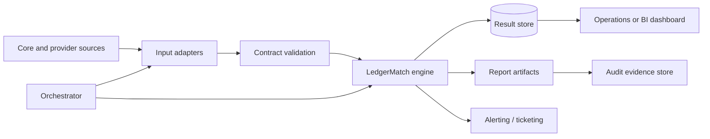

# Implementation Guide

This guide covers running LedgerMatch, integrating it into real operational workflows, hardening it for shared use, and extending it without weakening the reconciliation control.

## Local setup

```bash
python3 -m venv .venv
source .venv/bin/activate
pip install -r requirements.txt
streamlit run app.py
```

Windows activation:

```powershell
.venv\Scripts\Activate.ps1
```

Requirements are declared in `requirements.txt`. The app is tested with Python 3.11 and Streamlit 1.67.

## Configuration

### Database location

By default, run history is stored at:

```text
data/reconciliation.db
```

Override it:

```bash
RECON_DB_PATH=/srv/ledgermatch/reconciliation.db streamlit run app.py
```

The parent directory is created automatically. The process user must have read/write access to the database and its directory.

### Streamlit configuration

Theme settings live in `.streamlit/config.toml`. Add deployment-specific settings under `[server]` or `[browser]` as needed, such as:

```toml
[server]
headless = true
port = 8501
address = "127.0.0.1"
```

Do not bind to a public interface without authentication, authorization, and TLS.

### Input mode

The application supports:

- **Upload CSV files** — operator-provided core and provider exports.
- **Built-in sample data** — `sample_data/*.csv` for demonstrations and regression checks.

## Practical implementation opportunities

These are the highest-value ways organizations can apply the current codebase. Effort estimates are indicative and assume the repository as-is.

| Opportunity | Business value | Effort | What is needed |
|---|---|---:|---|
| Daily payment operations console | Faster exception triage, reduced spreadsheet work | Low | Use the app as-is; define export and review procedures |
| Pre-settlement control | Prevent unresolved breaks from reaching settlement sign-off | Low–Medium | Add a scheduled run and a go/no-go policy around summary thresholds |
| Scheduled batch reconciliation | Consistent daily execution and evidence capture | Medium | Wrap the engine in a job, add outputs, alerting, and retention |
| Incident reconciliation | Bound duplicate/dropped transactions after an outage | Low | Use the current app on an incident-specific export window |
| Migration validation | Prove record completeness and field parity before cutover | Low–Medium | Define acceptance thresholds and preserve evidence per parallel run |
| Embedded reconciliation library | Reuse validated matching in an internal service | Medium | Import `recon.engine`; add an API/worker layer |
| Warehouse/BI integration | Enterprise reporting and trend analysis | Medium–High | Persist results in a warehouse and expose reconciliation metrics |
| Workflow/ticketing integration | Route exceptions to owners and track resolution | Medium–High | Add stable exception IDs, ownership, status update, and write-back |
| Multi-source reconciliation | Compare more than two systems | High | Generalize the two-source model to N sources or pairwise runs |

---

## Pattern 1 — Daily operations console

**Best for:** a payment operations team that already receives daily CSV exports.

**Workflow**

1. Core banking export is generated after the daily posting window.
2. Provider settlement export is retrieved from the provider portal or SFTP drop.
3. An analyst uploads both files to LedgerMatch.
4. The analyst filters discrepancies and assigns investigation work outside the tool (email, ticket, spreadsheet, or operations system).
5. The analyst downloads the Excel workbook and attaches it to the daily control evidence.

**Operational policy to define**

- Who runs the reconciliation and by when.
- Which discrepancy categories require same-day action.
- Whether any result can be waived and how waivers are recorded.
- Where exports are stored and for how long.
- What backup process exists if the app or database is unavailable.

**Current gap to address:** saved history does not include raw source rows. Retain the original CSVs alongside the exported report if historical source evidence is required.

---

## Pattern 2 — Scheduled batch reconciliation

**Best for:** routine daily or intraday runs without manual uploads.

The current application exposes the engine and persistence functions as Python APIs, so a batch wrapper can be small. The example below is illustrative; actual file retrieval, secrets, scheduling, and alert delivery depend on your environment.

```python
from pathlib import Path

from recon.db import save_reconciliation
from recon.engine import CSVValidationError, reconcile_files
from recon.reports import build_csv_report, build_excel_report

CORE = Path("/data/incoming/core.csv")
PROVIDER = Path("/data/incoming/provider.csv")
OUT = Path("/data/outgoing")
OUT.mkdir(parents=True, exist_ok=True)

try:
    result = reconcile_files(CORE, PROVIDER)
except CSVValidationError as exc:
    # Send input-validation failure to the operations channel.
    raise SystemExit(f"Reconciliation input rejected: {exc}") from exc

run_id = save_reconciliation(result)
stamp = result.generated_at.strftime("%Y%m%d_%H%M%S")
(OUT / f"reconciliation_{stamp}.xlsx").write_bytes(build_excel_report(result))
(OUT / f"reconciliation_{stamp}.csv").write_bytes(build_csv_report(result))
(OUT / f"discrepancies_{stamp}.csv").write_bytes(
    build_csv_report(result, discrepancies_only=True)
)

if result.summary["discrepancies"] > 0:
    # Replace with your alerting/notification integration.
    print(f"Run {run_id} has {result.summary['discrepancies']} discrepancies")
```

**Production additions**

- Idempotency key based on source file hashes and business date.
- Run log with status, duration, input row counts, and output location.
- Alert thresholds by category.
- Retention and archival policy.
- Dead-letter handling for malformed or missing files.
- Scheduled task monitoring and missed-run alerts.

---

## Pattern 3 — Pre-settlement gate

**Best for:** preventing breaks from being implicitly accepted at settlement.

Suggested policy:

| Condition | Action |
|---|---|
| No records or invalid input | Block; investigate export pipeline |
| Missing in core or provider > 0 | Block or require controller approval |
| Amount mismatch > 0 | Block or require maker-checker approval |
| Duplicates > 0 | Block; review for double capture |
| Date mismatch only | Warn and route to operations |
| Status mismatch only | Warn and route to operations |
| All exact matches | Permit sign-off |

LedgerMatch currently reports the facts; it does not implement approvals. Add an explicit control layer with named reviewers, timestamps, and evidence links before using it as a hard gate.

---

## Pattern 4 — Migration or cutover validation

**Best for:** legacy-to-new platform migrations.

Compare legacy and new-system exports over a representative period, then define acceptance criteria:

- 100% of expected references present.
- 0 duplicate references.
- 0 amount mismatches.
- Date differences explicitly classified as processing latency.
- Status mappings agreed and documented.
- Every exception listed in the cutover evidence pack.

Run reconciliation repeatedly across batches and trend the summary metrics. Store outputs per batch outside LedgerMatch if longer-term evidence retention is required.

---

## Pattern 5 — Embedded library

**Best for:** an internal service or data platform that already retrieves the files.

```python
from recon.engine import reconcile_files

result = reconcile_files(core_bytes, provider_bytes, core_filename="core.csv")
if result.summary["missing_total"]:
    raise RuntimeError("Missing transactions require investigation")
```

The matching engine has no Streamlit dependency. Persist using `recon.db` or map `result.details` into your own repository.

**Adapter boundary**

The current engine expects CSV bytes/paths and exposes normalized DataFrames. If your source is an API, warehouse query, or Parquet table, the cleanest short-term approach is to produce a canonical CSV in a temp file and call `load_transactions()`/`reconcile_files()`. A more scalable long-term design is to extract normalization into an adapter that returns the same normalized schema and then feed `reconcile_transactions()`.

Do not bypass normalization and construct `reconcile_transactions()` inputs manually unless you preserve all required columns and invariants.

---

## Reference integration architecture



### Input adapter contract

An adapter should produce either:

1. A CSV that satisfies the public input contract, or
2. A normalized DataFrame with at least:

```text
reference
amount_cents
transaction_date
status_key
```

and optionally the display fields used by reports.

The safest extension is to add a new loader beside `load_transactions()` that reuses the amount/date/status normalization functions and returns the same schema.

---

## Customization recipes

### Add a status synonym mapping

Define an explicit mapping before comparison, for example:

```python
STATUS_MAP = {
    "SUCCESS": "COMPLETED",
    "SETTLED": "COMPLETED",
    "DECLINED": "FAILED",
}
```

Apply it to both normalized statuses and record the mapping in the run metadata. Do not silently infer synonyms without documenting the policy. Add tests for every approved mapping.

### Add an amount tolerance

A tolerance changes the control’s meaning. If you add one:

- Make it explicit in configuration and reports.
- Show the actual difference and the tolerance used.
- Keep exact-match and within-tolerance counts separate.
- Do not hide differences inside a rounded match.

Example policy:

```text
amount_difference == 0                          -> exact amount match
abs(amount_difference) <= tolerance             -> within tolerance
abs(amount_difference) > tolerance              -> mismatch
```

### Compare currency

Today, currency is captured for display but not compared. To treat a currency mismatch as a discrepancy:

1. Add `Currency` to the mismatch evaluation.
2. Extend `mismatch_fields`, summary counts, and exports.
3. Decide whether FX conversion is in scope. Do not compare different currencies as if their numeric amounts were equivalent.

### Add an extra field comparison

Add the field to:

- The normalized source frame.
- Comparison logic and mismatch labels.
- `DETAIL_COLUMNS`.
- Summary counts if required.
- UI view labels.
- CSV/Excel labels and tests.

### Add warning-only fuzzy reference suggestions

Fuzzy matching can help identify likely pairs, but it should not auto-match financial records. A safe design:

1. Exact-reference matching remains the source of truth.
2. Missing references receive suggested candidates with a similarity score.
3. Suggestions are labeled advisory and excluded from matched counts.
4. A human must confirm any remediation in source systems.

### Add authentication

For a shared deployment, terminate authentication at a reverse proxy (SSO/OIDC) or use a supported Streamlit auth wrapper. Enforce role-based access and audit downloads. Do not rely on a hidden sidebar or network address for security.

### Add retention and redaction

Define:

- Retention period for SQLite rows and exported files.
- Deletion procedure for customer data requests.
- Redaction policy for reports.
- Archive location and access controls.
- Backup encryption and restore testing.

### Route exceptions to a ticketing system

Create one stable exception ID per reference, for example:

```text
{run_id}:{reference}:{result}
```

Store the ticket ID and resolution state in your own workflow store. LedgerMatch does not currently persist arbitrary metadata.

---

## Production hardening checklist

### Identity and access

- [ ] SSO/authentication enabled.
- [ ] Role-based access for operators, reviewers, and auditors.
- [ ] Least-privilege host and filesystem accounts.
- [ ] Session timeout and secure cookies.

### Network and transport

- [ ] HTTPS with a valid certificate.
- [ ] Restricted ingress; no public exposure by default.
- [ ] Egress restricted where practical.
- [ ] Reverse proxy request limits and timeouts.

### Data protection

- [ ] Classify uploaded fields (PII, financial data).
- [ ] Encrypt storage volume and backups at rest.
- [ ] Define retention and deletion policies.
- [ ] Redact if reports leave the trusted boundary.
- [ ] Protect downloaded exports.

### Application controls

- [ ] Maker-checker or approval workflow for settlement gates.
- [ ] Explicit policy for duplicates, tolerances, and status mappings.
- [ ] Run metadata includes operator identity.
- [ ] Audit log for uploads, runs, exports, and history access.
- [ ] Error messages do not expose sensitive internals.

### Reliability

- [ ] Database backup and restore tested.
- [ ] Retention/pruning job.
- [ ] Monitor disk usage, failed runs, and database errors.
- [ ] Health checks and restart policy.
- [ ] Alerting for missed scheduled runs.
- [ ] Capacity plan for expected file sizes and concurrent users.

### Software supply chain

- [ ] Dependency vulnerability scanning.
- [ ] Reproducible or pinned dependency builds.
- [ ] Container image scanning if containerized.
- [ ] Reviewed upgrades for Python, Streamlit, Pandas, and openpyxl.
- [ ] Automated tests run in CI.

---

## Deployment options

### A. Workstation (current supported model)

- `streamlit run app.py`
- Local SQLite and local browser.
- No authentication.
- Suitable for a single trusted analyst and evaluation.

### B. Internal shared host

- Run behind a reverse proxy with SSO and TLS.
- Mount a protected persistent volume for `data/`.
- Restrict access to the operations network.
- Use a dedicated service account.
- Add audit logging at the proxy and application layers.
- Treat SQLite concurrency as a scalability limit.

### C. Containerized internal service

- Build an image with the repository and dependencies.
- Persist `/app/data` as a volume.
- Inject `RECON_DB_PATH` and any future configuration through the environment.
- Run as a non-root user.
- Add health checks and resource limits.
- Authenticate at the platform ingress.

No Dockerfile is included in the current project. If one is added, pin base images and run a non-root process.

### D. Batch service with a reporting UI

This is the recommended path for production scale:

- Scheduled worker retrieves and validates files.
- Engine runs in the worker.
- Results are written to a managed database and evidence store.
- A lightweight UI reads results rather than processing uploads.
- Alerts and workflow integration run outside the UI.

---

## Performance and scale

| Area | Current behavior | Practical limit |
|---|---|---|
| CSV parsing | Entire file in memory | Depends on host memory |
| Matching | Pandas group-by | Typical daily batches are fine; benchmark before promising millions of rows |
| Search/filter | In-memory DataFrame | Interactive for modest data; pagination for large data |
| Excel | Entire workbook in memory | Excel sheet limit is 1,048,576 rows including header |
| CSV | Entire result in memory | Streaming needed for very large exports |
| SQLite | One local database file | Not designed for high-concurrency multi-user writes |
| Session | Result held in memory per browser session | Memory grows with result size and concurrent users |

For larger volumes:

1. Stage raw files in object storage.
2. Validate incrementally.
3. Use database joins for matching.
4. Paginate UI results.
5. Generate reports asynchronously.
6. Store exceptions in a proper database.
7. Keep the exact-reference rule as the control, even if the implementation becomes SQL-based.

---

## Rollout plan

### Phase 1 — Local pilot

- Use synthetic and masked data.
- Confirm required CSV fields and status vocabulary.
- Define the discrepancy policy and reviewer.
- Run in parallel with the current manual process.
- Compare results and resolve mapping differences.

### Phase 2 — Controlled operations use

- Add operator identity and an approval trail.
- Schedule runs or formalize the manual upload ritual.
- Establish retention locations for source CSVs and reports.
- Add alerting for input failures and high-severity breaks.
- Back up the SQLite file.

### Phase 3 — Production hardening

- Authentication, TLS, RBAC, and network restriction.
- Audit logging and monitoring.
- Database retention/archival.
- Dependency and vulnerability management.
- Documented disaster recovery.

### Phase 4 — Scale and workflow integration

- Move processing to a worker and results to a managed database.
- Add ticketing and ownership.
- Expose metrics to BI.
- Extend adapters and field comparisons under a controlled change process.

---

## Risks and mitigations

| Risk | Impact | Mitigation |
|---|---|---|
| Upstream reference formats differ | Records appear missing | Enforce a reference contract; monitor unmatched prefixes; normalize upstream |
| Status vocabularies differ | False status mismatches | Maintain explicit, tested mapping policy |
| Currency not compared | Numeric matches across currencies could look valid | Add currency comparison and FX policy |
| Duplicate values differ between rows | First-row display may not tell the full story | Review source records; enhance duplicate detail reporting |
| Whole-file validation fails | One bad row blocks the run | Correct the export; or add a deliberate invalid-row policy with audit trail |
| SQLite available only locally | No central enterprise history | Move to managed database before multi-user rollout |
| Raw source not stored with run | Historical contextual review limited | Retain source CSVs in an evidence store |
| Formula injection in exported files | Spreadsheet execution risk | Existing neutralization plus operator awareness |
| Local app exposed without auth | Unauthorized access to financial data | Restrict network; add SSO and TLS |
| No user identity in history | Weak accountability | Add authenticated audit metadata |

---

## Related documentation

- [Product overview](product-overview.md)
- [Architecture](architecture.md)
- [How it works](how-it-works.md)
- [Data reference](data-reference.md)
- [API reference](api-reference.md)
- [Operations](operations.md)
