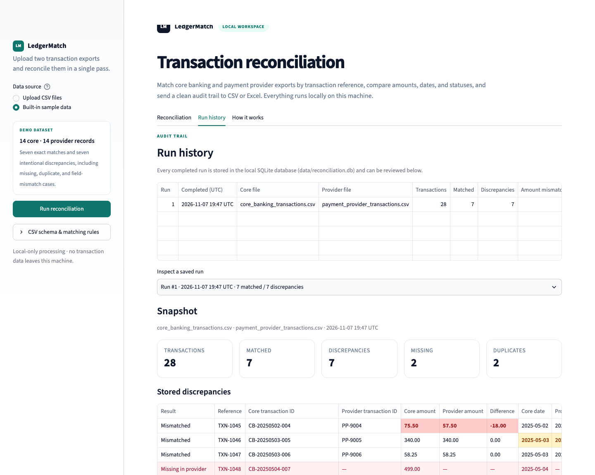

# Operations

This page covers running, testing, backing up, monitoring, and troubleshooting LedgerMatch.

## Operating model

The default deployment is a local, single-user Streamlit process with a local SQLite database. It expects:

- Two UTF-8-compatible CSV files.
- A writable `data/` directory or configured `RECON_DB_PATH`.
- A browser session for review and downloads.
- An operator who is authorized to view the transaction data.

There is no background worker, external queue, or network API.

## Start and stop

### Start

```bash
source .venv/bin/activate
streamlit run app.py
```

With a custom port:

```bash
streamlit run app.py --server.port 8502
```

With a custom database location:

```bash
RECON_DB_PATH=/srv/ledgermatch/reconciliation.db streamlit run app.py
```

### Stop

Press `Ctrl+C` in the terminal running Streamlit.

### Health check

Streamlit serves a health endpoint:

```bash
curl http://127.0.0.1:8501/_stcore/health
```

Expected response:

```text
ok
```

## Configuration reference

| Setting | Mechanism | Default |
|---|---|---|
| Database path | `RECON_DB_PATH` env var or function argument | `data/reconciliation.db` |
| Theme | `.streamlit/config.toml` | Teal/white LedgerMatch theme |
| Upload size | Streamlit server configuration | Streamlit default |
| Port/address | Streamlit CLI or config | Streamlit default |
| Authentication | Not built in | None |

## Running the tests

From the repository root:

```bash
source .venv/bin/activate
pytest -q
```

Current expected result:

```text
17 passed
```

### Test map

| Test area | What it verifies |
|---|---|
| Sample dataset | End-to-end counts and classification |
| Amount mismatch | Signed difference and amount-mismatch summary |
| Date and status mismatch | Combined mismatch fields |
| Status case-insensitivity | `completed` and `COMPLETED` match |
| Missing records | Missing in both directions |
| Duplicate in core | Duplication is not forced into a match |
| Duplicate in provider | Provider-side duplication |
| Duplicate in both | Both-source duplication |
| Aliases/amount formats | Header aliases and currency-formatted amounts |
| Missing columns | Clear `CSVValidationError` and missing-column metadata |
| Invalid amount/date | Row-level issues and CSV row numbers |
| Empty/unreadable CSV | Graceful input failure |
| SQLite round trip | Run and detail persistence/retrieval |
| CSV export | Full and discrepancy-only files |
| Excel export | Sheet layout, summary values, highlighting |
| Formula injection | Export text neutralization |
| Source immutability | Reconciliation does not mutate source frames |

Run a specific test:

```bash
pytest -q tests/test_reconciliation.py::test_sample_dataset_reconciles_to_expected_counts
```

Run with verbose output:

```bash
pytest -v
```

## Manual verification checklist

Use this after changing UI or dependencies:

- [ ] App starts without an exception.
- [ ] Sidebar switches between upload and sample modes.
- [ ] Sample run produces 28 total transactions, 7 matched, and 7 discrepancies.
- [ ] Six summary metrics render correctly.
- [ ] Discrepancy filters update the row count.
- [ ] Search filters by reference, transaction ID, and customer.
- [ ] Missing rows and mismatched amount cells are visibly highlighted.
- [ ] Matched and source-record tabs load.
- [ ] All three download buttons are present.
- [ ] CSV and Excel downloads open correctly.
- [ ] Run history shows the completed run and its snapshot.
- [ ] Uploading a file with missing columns produces a readable validation error.
- [ ] Uploading no files produces a clear prompt rather than a crash.

The project was HTTP- and browser-smoke-tested during development at a temporary local port; no server is left running by the repository itself.

## Data lifecycle

### Per-run data

1. CSV bytes are read into memory.
2. Normalized DataFrames exist in the Streamlit session.
3. Detail rows and summary are written to SQLite on successful completion.
4. Report bytes are prepared for downloads.
5. Session state is lost when the browser session ends or the server restarts.

### Retained data

SQLite retains:

- Run metadata.
- Summary JSON.
- Reference-level detail rows.

SQLite does **not** retain:

- Original uploaded CSV files.
- Raw source rows.
- A user identity.

If audit or investigation requires historical source review, retain the original CSVs in an evidence store alongside the exported report and run id.



_Figure: SQLite-backed run history with a stored discrepancy snapshot._

### Suggested retention policy

Define explicit periods, for example:

- Raw source CSVs: 90 days or per finance policy.
- Reconciliation exports: 7 years or per retention policy.
- SQLite history: 12–24 months online, then archive.
- Access logs: per security policy.

These values are examples, not recommendations for a specific regulatory regime. Align them with your organization's controls.

## SQLite operations

### Inspect the database

```bash
sqlite3 data/reconciliation.db
```

```sql
.headers on
.mode column

.tables

SELECT id, created_at, core_filename, matched, discrepancies
FROM reconciliation_runs
ORDER BY id DESC
LIMIT 10;

SELECT reference, result, amount_difference, mismatch_fields
FROM reconciliation_results
WHERE run_id = 1 AND result != 'Matched';
```

### Backup

Use SQLite's online backup command rather than copying a live database file:

```bash
mkdir -p backups
sqlite3 data/reconciliation.db ".backup 'backups/reconciliation-$(date +%Y%m%d-%H%M%S).db'"
```

Verify the backup:

```bash
sqlite3 backups/reconciliation-YYYYMMDD-HHMMSS.db "PRAGMA integrity_check;"
```

Expected:

```text
ok
```

### Restore

Stop the app first, then replace the database file with a verified backup.

```bash
cp data/reconciliation.db data/reconciliation.db.before-restore
cp backups/reconciliation-YYYYMMDD-HHMMSS.db data/reconciliation.db
```

Start the app and confirm that history loads.

### Archive and prune old runs

The schema uses `ON DELETE CASCADE` for result rows. Ensure foreign keys are enabled before deleting runs:

```sql
PRAGMA foreign_keys = ON;

DELETE FROM reconciliation_runs
WHERE created_at < date('now', '-365 days');
```

`created_at` is an ISO timestamp. For precise timezone-aware cutoff, use a tested application script instead of an ad hoc SQL statement.

### Database integrity check

```bash
sqlite3 data/reconciliation.db "PRAGMA integrity_check;"
```

If the integrity check fails:

1. Stop the app.
2. Preserve the damaged file for investigation.
3. Restore the latest verified backup.
4. Re-run recent reconciliations if source files are available.

## Monitoring

The app does not include a metrics endpoint or structured logging. For local use, monitor the terminal and the UI. For shared deployment, add:

| Signal | Why it matters |
|---|---|
| App process uptime | Detect crashes or failed restarts |
| HTTP health endpoint | Basic availability |
| Input validation failures | Detect upstream export problems |
| Run duration | Detect volume or performance changes |
| Discrepancy counts by category | Detect control breaks and spikes |
| Missing/duplicate totals | High-severity operational signals |
| SQLite write failures | Prevent silent loss of audit history |
| Database file size / disk free | Prevent storage exhaustion |
| Download failures | Ensure evidence can be retrieved |
| Concurrent session count | Assess SQLite and memory pressure |
| Dependency vulnerabilities | Maintain secure operation |

### Suggested alert thresholds

Thresholds should come from your own baseline. Reasonable operational examples:

- Any input validation failure: alert the export owner.
- Missing total > 0: alert operations.
- Duplicate total > 0: alert payments/operations immediately.
- Amount mismatches exceed a daily baseline: investigate upstream release or provider change.
- No run completed by the expected daily deadline: alert the batch owner.
- SQLite write failure: page support and preserve outputs.

## Failure and incident procedures

### Input validation failure

1. Open the displayed row-level error details.
2. Check for missing headers, encoding issues, wrong delimiter, or malformed values.
3. Compare the export layout with the [input contract](data-reference.md#input-files).
4. Correct the export or route it back to the data owner.
5. Do not bypass validation by manually removing problematic rows without documenting the decision.

### Unexpected mismatch spike

1. Compare provider status vocabulary and export format with the previous run.
2. Check for provider or core release changes.
3. Verify timezone and date-format behavior.
4. Inspect specific references and transaction IDs in the source systems.
5. Preserve the input files and report as incident evidence.

### Duplicate spike

1. Treat it as a potential double-capture event.
2. Identify duplicated references and transaction IDs in the source-record views.
3. Check provider retry/outage history.
4. Escalate according to the payments incident policy.
5. Do not accept the reconciliation until duplicates are explained.

### Database unavailable

The current result and downloads remain usable if persistence fails. To preserve evidence:

1. Download the Excel and CSV reports immediately.
2. Save the original input files.
3. Record the error shown in the UI.
4. Restore database access and rerun if required.

### Report generation failure

The UI may still show the result and offer other formats. Preserve the underlying result by exporting a working format, then investigate the failed dependency (usually `openpyxl` or available memory).

## Troubleshooting

| Symptom | Likely cause | Resolution |
|---|---|---|
| `streamlit: command not found` | Virtual environment not active or dependencies missing | Activate `.venv`, run `pip install -r requirements.txt` |
| `ModuleNotFoundError: recon` | Running `pytest` outside repo root without config, or app launched from another directory | Run from repository root; `pytest.ini` adds the root to `pythonpath` |
| Port 8501 already in use | Another Streamlit process | Use `--server.port 8502` or stop the other process |
| CSV rejected as missing columns | Headers do not match required aliases | Check [aliases](data-reference.md#accepted-column-aliases) |
| Row-level invalid amount | Currency formatting not recognized or wrong column mapped | Inspect CSV row and normalize the amount |
| Row-level invalid date | Ambiguous or malformed date | Prefer ISO `YYYY-MM-DD` |
| Everything is missing | Wrong reference column, delimiter, or date comparison | Validate headers and inspect source records |
| History tab empty | No successful runs, database not writable, or custom path differs | Check `data/reconciliation.db`, permissions, and `RECON_DB_PATH` |
| Duplicate count is higher than expected | Additional rows share the same reference | Review source-record views and transaction IDs |
| Excel download fails | Memory pressure or workbook size beyond Excel limits | Use CSV; reduce the batch; split periods |
| Search finds no records | Only discrepancy rows are searched | Clear filters or inspect the Matched tab |
| `.xlsx` opens with a security warning | Formula-like cells were neutralized, or the file came from an untrusted source | Follow local spreadsheet security policy; source export is still required |
| App exposed to the network | Streamlit bound outside localhost | Stop it and place it behind authenticated TLS infrastructure |

## Upgrade and maintenance

### Dependency upgrades

1. Create a branch.
2. Update `requirements.txt`.
3. Recreate or update `.venv`.
4. Run `pytest -q`.
5. Start the app and complete the manual verification checklist.
6. Review Streamlit/Pandas deprecation warnings.
7. Test opening CSV and Excel exports in the target spreadsheet software.
8. Merge and deploy.

### Database changes

There is currently no schema migration framework. Before changing the SQLite schema:

1. Back up the database.
2. Add an explicit migration or recreate the database.
3. Document compatibility with existing history.
4. Test `save_reconciliation()` and `get_run()` against the migrated schema.

### Backup verification

At least quarterly, restore a backup to a temporary location and verify that it opens and lists runs. A backup that has never been restored is not a verified backup.

## Security operations

Minimum controls for anything beyond a local trusted workstation:

- SSO and role-based access.
- HTTPS.
- Restricted network ingress.
- Encrypted storage and backups.
- File upload size limits.
- Dependency scanning.
- Audit log retention.
- Documented retention/deletion policy.
- Separation of duties for settlement approval.
- Secure disposal of downloaded reports and source CSVs.

Review the [production hardening checklist](implementation-guide.md#production-hardening-checklist) before a shared deployment.

## Known limitations

- Exact-reference matching only; no fuzzy or tolerance matching.
- Single-currency numeric comparison; no FX conversion.
- Calendar-day date matching; time-of-day differences ignored.
- Status synonyms are not mapped automatically.
- Duplicate detail rows use the first record’s display values.
- Raw source rows are not persisted in history.
- SQLite is not designed for high-concurrency multi-user access.
- No authentication, authorization, audit log, or API.
- Excel export is in memory and bounded by Excel limits.
- The UI filters over the full in-memory result.
- No automatic retention/pruning.

## FAQ

**Does LedgerMatch modify the uploaded files?**  
No. It reads them into memory. Source frames are not mutated by reconciliation.

**Are transaction amounts stored as floating point in the comparison?**  
No. They are parsed with `Decimal`, quantized, and compared as integer cents. SQLite stores display amounts as REAL for convenience.

**Why is a reference not matched when the amount and date look right?**  
Status may differ, or the reference may have surrounding whitespace/case differences, or one source may have multiple rows. Check the review note and mismatch fields.

**Why does one duplicate reference count as two transactions?**  
Total transactions counts raw rows. The reference is one discrepancy case, but duplicate extra records quantifies the additional rows.

**Can I reconcile more than two files?**  
Not in a single run. Run pairwise reconciliations or extend the engine.

**Can I schedule it?**  
The app itself is manual, but the Python engine can be wrapped in a scheduled job. See [Scheduled batch reconciliation](implementation-guide.md#pattern-2--scheduled-batch-reconciliation).

**Can I use it with real customer data?**  
It is designed for local processing, but you must apply your organization's security, privacy, retention, and access-control requirements. Do not expose an unauthenticated Streamlit server to an untrusted network.

**Where are downloaded reports stored?**  
Only in the browser download location chosen by the operator. The app does not keep a server-side report archive.

**What happens if SQLite fails?**  
The reconciliation result remains visible and downloadable, and the UI shows a save warning. Preserve outputs and original files.

## Related documentation

- [Architecture](architecture.md)
- [How it works](how-it-works.md)
- [Data reference](data-reference.md)
- [API reference](api-reference.md)
- [Implementation guide](implementation-guide.md)
