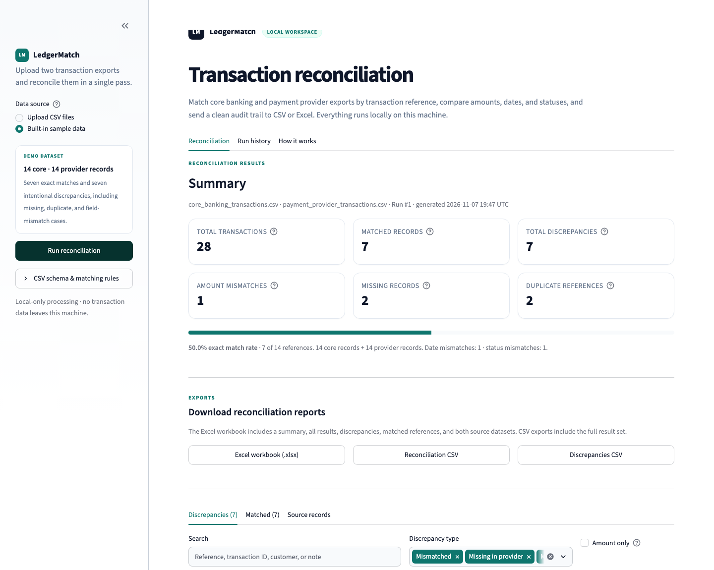

# Product Overview

## The problem

Payment operations teams reconcile transactions across systems that were never designed to agree in real time. A transaction may be recorded in a core banking platform, captured by a payment provider, and settled through a separate processor. Each system has its own IDs, status vocabulary, latency, and failure modes.

Typical symptoms of an unreconciled process:

- Finance cannot prove that every provider transaction reached the ledger.
- Customer support sees a payment marked complete in one system and pending in another.
- Operations teams manually compare spreadsheets, often after month-end.
- Duplicate captures are discovered only after settlement.
- Auditors ask for evidence of who reviewed which exception.

Manual comparison is slow, inconsistent, and hard to audit. LedgerMatch turns the comparison into a repeatable, transparent batch workflow with a clear evidence trail.

## What LedgerMatch is

LedgerMatch is a **local-first financial transaction reconciliation tool**. It ingests two CSV exports, aligns transactions on a shared reference, and classifies every reference into one of a small set of operational outcomes:

- **Matched** — both systems agree on amount, date, and status.
- **Mismatched** — both systems have the transaction, but at least one compared field differs.
- **Missing in core** — the provider has the transaction; the core bank export does not.
- **Missing in provider** — the core bank has the transaction; the provider export does not.
- **Duplicate in core**, **Duplicate in provider**, or **Duplicate in both** — the same reference appears multiple times in one or both sources.

Every result is presented in a searchable, filterable interface and can be exported as CSV or a formatted Excel workbook.

## Who it is for

| Persona | Primary need | How LedgerMatch helps |
|---|---|---|
| Payment operations analyst | Find and resolve today’s exceptions | Fast upload, discrepancy counts, search, row-level highlighting |
| Reconciliation / treasury analyst | Prove that provider settlements agree with the ledger | Reference-level comparison and downloadable evidence |
| Finance controller | Understand reconciliation health | Match rate and categorized discrepancy totals |
| Internal audit / compliance | Retain reviewable evidence | Local SQLite run history and timestamped exports |
| Data or platform engineer | Build a reconciliation workflow | Small, importable Python engine with tests and explicit data contracts |
| Product / operations lead | Evaluate a reconciliation control | Built-in realistic demo with explainable outcomes |

## Primary workflow

1. **Export** — Download transaction CSVs from the core banking system and payment provider.
2. **Select** — Choose **Upload CSV files** in the sidebar and provide both files, or use **Built-in sample data** for evaluation.
3. **Run** — Select **Run reconciliation**. LedgerMatch validates the files before matching.
4. **Review** — Examine total transactions, matches, discrepancies, amount mismatches, missing records, and duplicates.
5. **Investigate** — Search and filter discrepancies; inspect highlighted missing rows, amount differences, date differences, and status differences.
6. **Export** — Download the reconciliation CSV, a discrepancies-only CSV, or the Excel workbook.
7. **Retain** — The run and its detailed result rows are saved in the local SQLite history.
8. **Resolve** — Investigate exceptions in the source systems and rerun after corrections.

_Figure: the result summary after running the built-in demo._

## Use cases

### 1. Daily payment operations control

A payments team exports the previous day’s provider activity and the corresponding ledger entries each morning. LedgerMatch identifies missing captures, amount differences, pending/complete status drift, and duplicates before settlement review.

**Value:** reduces manual comparison time and gives analysts a prioritized exception queue.

### 2. Provider settlement assurance

Before accepting a provider settlement report as complete, operations compares provider records with the internal ledger. Missing records or amount differences are investigated before reconciliation sign-off.

**Value:** creates a repeatable pre-sign-off checkpoint with downloadable evidence.

### 3. Incident and outage review

After a provider outage or retry storm, the team runs reconciliation over the affected window to identify duplicate captures, dropped transactions, and status inconsistencies.

**Value:** quickly bounds the incident and supports customer remediation.

### 4. Migration and cutover validation

During a payment platform or ledger migration, the team compares records from the legacy and new systems in a controlled parallel run.

**Value:** validates record completeness and field parity before cutover.

### 5. Month-end and audit support

A controller uses the Excel workbook and the SQLite run history to demonstrate the reconciliation performed for a period, including counts and exception details.

**Value:** improves audit readiness and reduces spreadsheet sprawl.

### 6. Internal tooling proof of concept

An engineering team uses the reconciliation engine as a reference implementation for a larger workflow that adds scheduling, object storage, authentication, and alerting.

**Value:** shortens discovery and provides a tested core matching model.

## What makes the workflow useful

### Explicit, explainable outcomes

Every reference lands in a named category. Operators do not need to interpret ambiguous match logic. The source rows remain available for investigation.

### Duplicate safety

Rather than arbitrarily picking one of several records sharing a reference, LedgerMatch flags the reference as a duplicate. This is deliberately conservative: a duplicate is an operational signal, not something to hide with automatic matching.

### Field-level evidence

Mismatched rows show both source values and a signed amount difference. The `Mismatch` column records whether amount, date, status, or several fields disagreed.

### Audit-friendly exports

Reports include the full comparison, the discrepancy subset, matched references, and both normalized source datasets. The workbook includes conditional highlighting for missing and mismatched records.

### Local data handling

The default deployment processes uploads locally and stores results in a local SQLite file. No external service is called as part of reconciliation.

## Scope and non-goals

LedgerMatch intentionally stays focused.

**In scope**

- CSV ingestion for two sources.
- Reference-based exact matching.
- Amount, calendar-date, and status comparison.
- Missing, duplicate, and mismatch classification.
- Local dashboard, search/filter, exports, and run history.
- Clear validation errors and automated tests.

**Out of scope by default**

- Ledger posting or payment initiation.
- Real-time streaming reconciliation.
- Automatic exception resolution or write-back to source systems.
- Multi-currency conversion or FX-rate application.
- Tolerances, fuzzy matching, or probabilistic record linkage.
- Authentication, authorization, and multi-tenancy.
- Enterprise scheduling, alerting, and workflow management.

These are not fundamental limitations of the design; they are deliberate boundaries for a small, reliable local tool. See [Practical implementation opportunities](implementation-guide.md#practical-implementation-opportunities) for safe ways to extend it.

## Operating assumptions

- Both files are CSV and UTF-8-compatible.
- Each file contains a reference, amount, transaction date, and status column, or a recognized alias.
- References are expected to be shared business identifiers. Internal system IDs may differ.
- Reference matching is exact after trimming surrounding whitespace.
- Amounts are signed values in a single currency context. Currency is retained for display but not converted.
- Dates are reconciled at calendar-day granularity.
- Statuses are compared case-insensitively after whitespace normalization.
- The operator is authorized to view the uploaded transaction data.

## Success criteria

A successful implementation should let an operator answer these questions without manual spreadsheet comparison:

1. How many records did each system send?
2. How many references matched exactly?
3. Which references are missing from either side?
4. Which references are duplicated?
5. Which records disagree on amount, date, or status?
6. What evidence can I download and retain?
7. Can I reproduce and review the result later?

LedgerMatch addresses all seven for a local, file-based workflow.

## Related documentation

- [Architecture](architecture.md)
- [How matching works](how-it-works.md)
- [Data reference](data-reference.md)
- [Implementation guide](implementation-guide.md)
- [API reference](api-reference.md)
- [Operations](operations.md)
